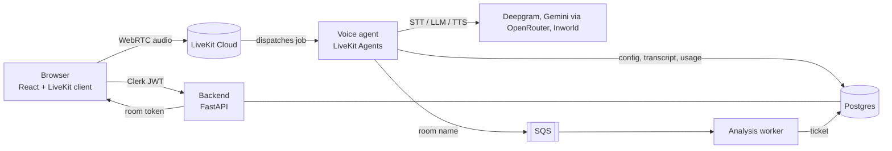

# Echolet

Echolet is an AI voice receptionist for small service businesses. An owner configures an
agent with their services, prices, hours and rules. The agent talks to callers in real time,
saves each call with a transcript, and writes a ticket with a summary, sentiment and action
items.

**Status:** in development. Calls currently run in the browser over WebRTC; phone numbers are
not supported yet. See [What's not done](#whats-not-done).

## Architecture



| Path | What it is |
|---|---|
| `backend/` | FastAPI. Clerk auth, agent CRUD, call sessions and LiveKit tokens, the public demo endpoint, Clerk webhooks. Async SQLAlchemy and Alembic. |
| `agent/` | LiveKit voice agent. Loads the session's agent config, runs speech-to-text, the LLM and text-to-speech, enforces the daily talk-time cap, saves the transcript, queues analysis. |
| `worker/` | Polls SQS, analyses the transcript against the agent's ticket fields, stores the ticket. |
| `frontend/` | React app: landing page with a live demo and waitlist, and the dashboard. `frontend/api/` holds two Vercel Functions (demo token, waitlist). |
| `tests/` | Python test suite for backend, worker and agent modules. |

### A call, end to end

1. The dashboard calls `POST /api/session/start`. The backend checks that the agent belongs
   to the user and that they have talk time left today, creates a `call_sessions` row, and
   returns a short-lived, microphone-only LiveKit token for that room.
2. The agent joins the room, finds the session by room name and builds its prompt from the
   agent's config. A room with no session gets no agent.
3. When the daily allowance runs out, the agent says goodbye and ends the call. On hang-up it
   saves the transcript, duration and usage, then sends the room name to SQS.
4. The worker writes the ticket.

Talk time is recorded only by the agent on the server.

### Demo calls

`POST /api/demo/session` needs no account. It returns a two-minute join token for a
`demo-<uuid>` room, with the demo clinic's config and a call-length cap in the token
metadata. The metadata is signed with the LiveKit secret, so the agent uses it without a
database lookup. Demo calls are not stored.

On the landing page this endpoint is a Vercel Function (`frontend/api/demo/session.js`)
with layered abuse protection: a Vercel Firewall rate limit; per-visitor hourly and daily
limits and a global daily budget kept in Postgres (IPs stored as salted hashes); a cap on
simultaneous demo calls read live from LiveKit; and the per-call time cap enforced by the
agent. If the database or LiveKit can't be reached it refuses the call. Limits are the
`DEMO_*` variables in `.env.example`.

## Getting started

Requirements: Python 3.13 with [uv](https://docs.astral.sh/uv/), Node 20, Postgres, and
accounts for LiveKit Cloud, Clerk, Deepgram, OpenRouter, Inworld and AWS SQS.

```bash
cp .env.example .env                       # fill in credentials
cp frontend/.env.example frontend/.env

cd backend && uv sync && uv run alembic upgrade head && cd ..
./dev.sh                                   # backend on :8000, agent, worker (dev.ps1 on Windows)
cd frontend && npm install && npm run dev  # http://localhost:5173
```

New users get a starter agent from the Clerk `user.created` webhook. To receive it locally,
expose `/api/clerk/webhooks` through a tunnel and set `CLERK_WEBHOOK_SIGNING_SECRET`.

## Tests

```bash
cd tests && uv sync && uv run pytest --cov   # unit, integration, e2e, security, resilience
cd frontend && npm run lint && npm test && npm run build
```

External services are mocked. The e2e test runs the real queue, worker and analyzer path with
only I/O mocked. CI (`.github/workflows/test.yml`) runs both with a coverage gate.

### Agent evals

`agent/evals/` runs the production agent in LiveKit's text test mode against the demo clinic,
using the real prompt builder, tools and model. Each case combines fixed checks (quoted price,
no markdown in speech, whether `end_call` fired) with an LLM judge for wording.

```bash
cd agent && uv sync && uv run pytest   # needs OPENROUTER_API_KEY, about 40 s
```

Cases cover answers from the knowledge base, invented prices, calendar claims, medical
advice, prompt injection, booking and hanging up. They run nightly and on demand
(`.github/workflows/evals.yml`). The first runs found two issues, both fixed: the model
ended calls mid-booking (`end_call` now requires a goodbye from the caller, see
`agent/call_ending.py`), and the starter agent sent dental emergencies to the ER.

## Deployment

**Full stack:** `docker compose up -d --build` runs everything behind Caddy. The backend's
`/health` endpoint checks the database and is the compose health check.

**Landing page only:** the landing page, live demo and waitlist can run without the backend.

1. Deploy the agent to LiveKit Cloud. Demo calls need no database or SQS.
   ```bash
   cd agent
   lk cloud auth
   lk agent create --secrets-file demo.secrets   # DEEPGRAM_API_KEY, OPENROUTER_API_KEY, INWORLD_API_KEY
   ```
2. Deploy `frontend/` to Vercel. Set `LIVEKIT_URL`, `LIVEKIT_API_KEY`, `LIVEKIT_API_SECRET`
   (same LiveKit project as the agent), `DATABASE_URL` (for the waitlist) and
   `VITE_CLERK_PUBLISHABLE_KEY`. Leave `VITE_API_BASE_URL` unset.
3. Add a Vercel Firewall rate limit on `/api/demo/session` and spend limits with the AI
   providers.

Without a deployed agent, set `DEMO_ENABLED=false` (or build with `VITE_LIVE_DEMO=false`)
and the demo panel shows a scripted example call. The dashboard always needs the backend.

## What's not done

- Phone numbers and inbound SIP. The agent handles SIP participants, but provisioning and
  trunking are not built.
- Website knowledge sources are passed to the model as a URL only. Text sources work.
- Integrations and actions are stored in the agent config but not executed.
- The agent's LiveKit session lifecycle is tested by hand; its logic is covered by unit tests
  and evals.
- No billing or plans.
