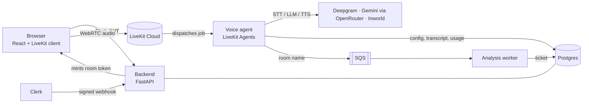

# Echolet

An AI voice receptionist for small service businesses. A business owner describes their
business once (identity, voice, services and prices, knowledge base, guardrails, which
details to capture), and Echolet answers callers in real time, saves every call with a
transcript, and turns it into a ticket with a summary, sentiment and action items.

Visitors can talk to a demo receptionist from the landing page without an account.

## Architecture



| Service | Path | Responsibility |
|---|---|---|
| Backend | `backend/` | Clerk auth, agent CRUD, starts call sessions and mints LiveKit tokens, public demo endpoint, Clerk webhooks, usage read-out. Async SQLAlchemy + Alembic. |
| Voice agent | `agent/` | Joins each room, loads that session's agent config, runs the STT → LLM → TTS pipeline, enforces the talk-time cap, saves the transcript, queues analysis. |
| Worker | `worker/` | Long-polls SQS, runs the LLM analysis against the agent's ticket fields, writes the result. Idempotent per call. |
| Frontend | `frontend/` | Landing page with live demo, dashboard (agents, sandbox calls, call history and tickets). |

### How a call works

1. The dashboard calls `POST /api/session/start` with an agent id. The backend checks the
   agent belongs to the caller and that they have talk time left today, creates a
   `call_sessions` row whose `room_name` is a fresh UUID, and returns a 10-minute LiveKit
   token scoped to that room (microphone only).
2. The agent is dispatched into the room, looks the session up by room name, and builds its
   prompt from the agent's JSONB config. Rooms with no matching session get no agent, so
   there is no way to start an unmetered conversation.
3. A background task ends the call (with a spoken goodbye) when the user's daily allowance
   runs out. On hang-up the agent writes the transcript, duration and usage, then sends the
   room name to SQS.
4. The worker picks it up, analyses the transcript, and stores the ticket.

**Talk time is accounted for only by the agent, on the server.** The browser never reports
usage.

### Public demo

`POST /api/demo/session` needs no account. It returns a 2-minute join token for a
`demo-<uuid>` room. The demo agent config (a fictional dental clinic, `backend/app/agent_templates/default.py`)
and the call length cap travel in the token's metadata, which is signed with the LiveKit
secret, so the agent can trust them without a database lookup. Demo calls are never stored or
analysed. Cost is bounded three ways: a per-IP hourly limit, a global daily budget, and the
per-call cap (clamped again by the agent). All are environment variables (`DEMO_*`, see
`.env.example`). The rate limiter is in-process: limits are per backend replica.

## Running locally

Prerequisites: Python 3.13 with [uv](https://docs.astral.sh/uv/), Node 20, a Postgres
database, and accounts for LiveKit Cloud, Clerk, Deepgram, OpenRouter, Inworld and AWS SQS.

```bash
cp .env.example .env                 # fill in credentials
cp frontend/.env.example frontend/.env

cd backend && uv sync && uv run alembic upgrade head && cd ..
./dev.sh                             # backend :8000, agent, worker  (dev.ps1 on Windows)
cd frontend && npm install && npm run dev   # http://localhost:5173
```

For the Clerk `user.created` webhook (which seeds a starter agent for each new user),
expose `/api/clerk/webhooks` with a tunnel and set `CLERK_WEBHOOK_SIGNING_SECRET`.

Production runs all services with `docker compose up -d --build` behind Caddy
(`Caddyfile`). The backend has a `/health` endpoint that checks database connectivity and is
used as the compose health check.

## Deploying the landing page and live demo without the backend

The landing page's live demo needs only two pieces, neither of which is the backend:

1. **Voice agent on LiveKit Cloud.** Demo calls need no database or SQS; the agent gets
   the persona and time cap from the signed token.
   ```bash
   cd agent
   lk cloud auth
   # demo.secrets: DEEPGRAM_API_KEY=..., OPENROUTER_API_KEY=..., INWORLD_API_KEY=... (one per line, never commit it)
   lk agent create --secrets-file demo.secrets   # builds agent/Dockerfile on LiveKit Cloud
   lk agent deploy                                # later versions
   ```
2. **Frontend on Vercel**, project root `frontend/`. `frontend/api/demo/session.js` is a
   Vercel Function that mints the demo token (same contract and token claims as the
   backend's `/api/demo/session`), so the landing page calls it on the same origin.
   Environment variables: `LIVEKIT_URL`, `LIVEKIT_API_KEY`, `LIVEKIT_API_SECRET` (same
   LiveKit project as the agent), `VITE_CLERK_PUBLISHABLE_KEY`, optional `DEMO_*` limits.
   Leave `VITE_API_BASE_URL` unset.

The function's rate limiter lives in instance memory, so also add a Vercel Firewall
rate-limit rule on `/api/demo/session` and set spend limits with the AI providers. If the
agent isn't deployed, set `DEMO_ENABLED=false` on Vercel (or build with
`VITE_LIVE_DEMO=false`) and the page shows the scripted example call instead. The dashboard
still needs the backend.

## Tests

```bash
cd tests && uv sync
uv run pytest                        # all suites
uv run pytest --cov                  # with coverage (backend + worker)
cd ../frontend && npm run lint && npm test && npm run build   # npm test: the Vercel demo function
```

The suite (`tests/`) is organised as `unit`, `integration`, `e2e`, `security` and
`resilience`. External services (LiveKit, OpenRouter, SQS, Postgres) are mocked; the e2e
test drives the real queue → worker → analyzer path with only I/O mocked. CI
(`.github/workflows/test.yml`) runs the Python suite with a coverage gate and lints and
builds the frontend.

## Agent evals

`agent/evals/` holds behavioural evals for the voice agent, built on LiveKit Agents'
test framework. Each one runs the production agent (real prompt builder, real `end_call`
tool, real Gemini via OpenRouter) in text mode against the demo clinic config, then
checks the reply with hard rules (quotes $120, no markdown in speech, no price it wasn't
given, `end_call` called or not) and an LLM judge for wording that can vary.

```bash
cd agent && uv sync && uv run pytest     # needs OPENROUTER_API_KEY; ~40s, a few cents
```

They cover answers from the knowledge base, not inventing prices or calendar access,
medical-advice and prompt-injection guardrails, booking flow, and when the agent may hang
up. They run nightly and on demand in CI (`.github/workflows/evals.yml`), not on every push.

They found two real bugs on their first run:

- Gemini called `end_call` mid-booking when a caller asked to confirm a time. `end_call`
  now refuses unless the caller's latest words are a goodbye (`agent/call_ending.py`).
- The starter agent sometimes sent a caller with a knocked-out tooth to the ER instead
  of offering the clinic's same-day emergency visit. Fixed in the template.

## Known limitations

- **No telephony yet.** Calls run over WebRTC from the browser. The agent already handles SIP
  participants (telephony noise cancellation), but phone-number provisioning and inbound
  SIP trunking are not built.
- **Website knowledge sources are not crawled.** A website source is passed to the model as a
  URL reference only; text sources are what the agent actually answers from.
- **Integrations and actions** in the agent config are stored but not executed.
- **The voice agent has little automated coverage.** Its demo handling is unit-tested; the
  LiveKit session lifecycle is verified by hand.
